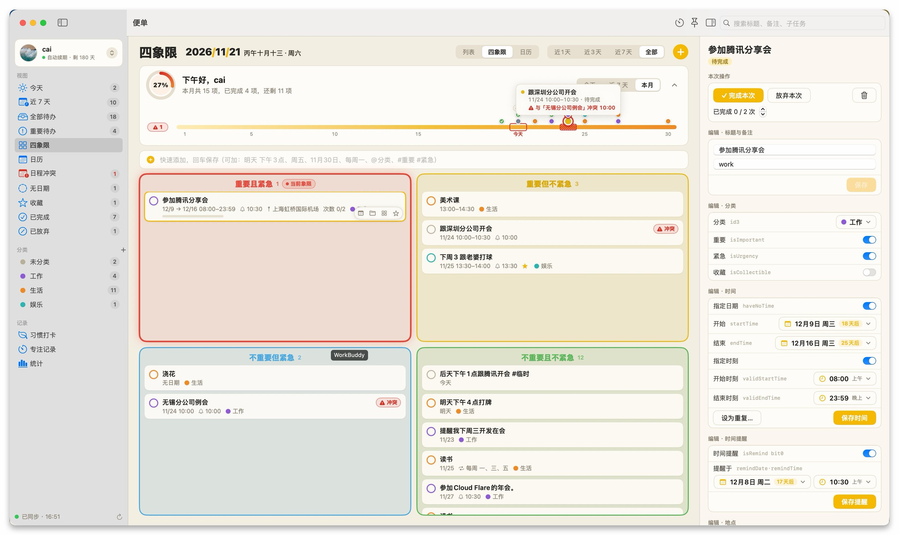
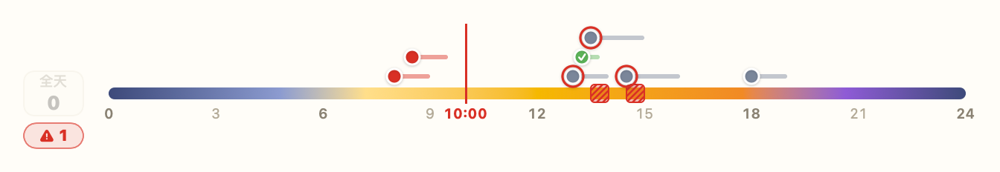

# 更新记录

便单 macOS 客户端（BiandanMac）的版本变化。最新版本在最上面。

打 tag 时用 `Tools/tag_release.sh <版本号>`，脚本会从这里取出对应版本的说明作为 tag 说明。

## [0.6.1] - 2026-11-21

### 新功能

- **四象限标出当前象限**：选中任务后，它所在的象限边框加粗、带一圈同色光晕，标题旁出现「● 当前象限」。⌘ 多选时，有选中项的象限都会高亮；点象限空白处可以直接选中这个象限；鼠标移上去时边框略微加深。
- **卡片快捷操作**：列表和四象限里，鼠标移到卡片上或选中卡片时，右下角浮出一排按钮：
  - 改期：今天 / 明天 / 下周一 / 无日期，保留原来的持续天数，重复任务只改这一次；
  - 移到分类：当前分类打勾，分类多时可以滚动；
  - 移到象限：四宫格，点哪格移到哪个象限；
  - 收藏 / 取消收藏。

  已完成、已放弃的任务只显示「分类」「收藏」；多选时（底部有批量操作栏）和日历小卡片上不显示。效果与右键菜单里的同名操作一致。

  

### 修复

- 侧栏「已完成」「已放弃」后面显示数量，和点进去看到的条数一致。
- 无日期任务放弃后，现在也会出现在「已放弃」列表里（以前看不到）。

## [0.6.0] - 2026-11-21

### 重点

- **日程冲突一眼可见**：新增「日程冲突」页，任务卡片和完成率卡片下面的时间条都会标出时间撞在一起的日程。
- **检查器终于点得动了**：修好了右侧检查器「点「开始」弹出「结束」、点「结束」和保存按钮没反应、只有回车能保存」的老问题。
- **编辑到一半不再丢**：自动同步或在别处保存后，正在编辑、还没保存的内容会保留下来。
- **新增统计页、导出与备份、全局快速添加、多选批量操作和完整的键盘操作。**

### 新功能

- **日程冲突**
  - 侧栏「视图 → 日程冲突」：按日期列出今天起 30 天内时间段交叉的待完成日程。全天任务、首尾刚好相接的、已经过去的不算。有冲突时侧栏图标和数字变红。
  - 快速添加、全局快速添加：按回车前红字提示会和哪项冲突；新建后有冲突，底部弹出提醒卡片，可以一键查看。
  - 列表、四象限、日历的卡片右上角显示「⚠︎ 冲突」。鼠标移上去列出和它冲突的日程和重叠时段，点一项直接跳过去。
  - 时间条标出冲突：
    - 今天视图：重叠的那段时间在渐变条上铺红色斜纹，冲突任务的圆点套红环；
    - 近 7 天 / 本月视图：有冲突的那天铺红色斜纹、日期标红，冲突任务优先显示，被收进「+N」时「+N」也变红；
    - 左侧「⚠︎ N」显示有几处冲突，点一下打开「日程冲突」页；
    - 鼠标悬停时提示卡片多一行红字，比如「与「公司例会」冲突 13:30–14:00」。

  

  

  （以上两张为测试数据渲染图）

- **统计页**：侧栏「记录 → 统计」。近 7 / 30 天按天、近 90 天按周统计：完成数、按期完成率、当前逾期、日均完成、专注时长，加上完成趋势和专注时长柱状图，以及待完成任务按象限和分类的分布。
- **导出与备份**：可以导出完整备份（JSON）、任务明细（CSV）、专注记录（CSV）、日历（ICS，可导入系统日历）。每天第一次同步成功后自动在本机备份一份，保留最近 7 份，也可以立即备份。入口在「设置 → 高级」和「文件」菜单。
- **全局快速添加**：在任何程序里按 ⌃⌥N（可改成 ⌥⌘N、⌃⇧空格或关闭），弹出一个不抢焦点的输入框，写法和快速添加栏一样，默认今天，回车保存，Esc 或点外面关闭。
- **快速添加认识更多写法**：
  - 日期：周五、下周三、11月30日、25号、今天 / 明天 / 后天；
  - 时刻：下午3点、15:30-16:30（会设好时间段和提醒）；
  - 重复：每天、工作日、每周一三五、每月15号、每年3月5日（后面可以跟时刻）；
  - 分类和习惯：@分类 或 #分类，#习惯；
  - 日期和时刻写在标题前面也能识别，比如「后天下午1点跟腾讯开会」；「明天的会议」「3点开会」这类不会被拆开；
  - 鼠标移到 ＋ 号上会弹出写法说明，点示例直接填进输入框。
- **多选与批量操作**：⌘ 点击卡片多选（列表、四象限、日历都可以），底部批量操作栏可以完成、放弃、改期、移到象限 / 分类、全选、删除。整批操作 ⌘Z 一步撤销，删除前会确认数量和范围。
- **键盘操作**：↑↓ 按显示顺序切换选中，⇧↑↓ 或 ⇧ 点击连选，空格完成，⌫ 删除（会先确认），回车编辑标题（标题框里回车保存），⌘A 全选，Esc 取消多选。在输入框、侧栏、弹窗里按键照常可用。
- **拖到侧栏**：把卡片拖到「今天」改期（保留持续天数，重复任务只改这一次），拖到「无日期」清除日期，拖到「收藏」「重要待办」或某个分类直接归类。拖的是多选里的卡片时整批处理，一次拖放一步撤销。
- **提醒通知上直接操作**：通知上多了「完成」「10 分钟后提醒」「1 小时后提醒」按钮，不用打开便单。
- **待同步队列明细**：「设置 → 同步」里逐条列出还没写回云端的修改：改了什么、什么时候排进来的、试了几次、最后一次的错误。可以逐条重试或放弃。
- **时间条悬停提示**：鼠标靠近圆点就弹出主题样式的提示卡片，点击选中离鼠标最近的任务，「+N」会列出被折叠的任务。

### 重大修复

- **检查器点击位置和画面错开**：右侧检查器里，实际能点的位置比画面上的按钮高了一个工具栏的高度（约 52pt），所以点画面上的「开始」会弹出「结束」的日历，点「结束」、「保存」、「保存时间」、「保存提醒」都没反应，只有按回车能保存。这个问题从第一版就有，现在画面和点击位置完全对齐，往下滚动后也对齐。

  

- **主窗口里鼠标点击失效**：窗口最大化、键盘监听、窗口置顶这几个看不见的辅助层不会再盖住界面、吞掉点击了。
- **编辑到一半的内容被清掉**：以前只要这个任务有了新版本（自动同步拉到了云端的修改，或者你在检查器的另一个分区点了保存），整个编辑区就会被换掉，没保存的修改直接丢，正在点的按钮那一下也会落空。现在只有切换到别的任务时才会重置。同一个任务来了新版本时，按分区处理：你改过、还没保存的分区（标题与备注、时间、时间提醒、地点、完成目标）保留你的修改，没改过的分区显示新内容。
- **登录回调端口被占用**：登录用的本机端口 42681 被占用时，会明确提示，并说明多半是 Python 版便单 MCP 在用，给出排查命令，不再直接打开浏览器后卡住。

### 调整

- 习惯的「连续」改为按周期计算：从最近一期往回数连续完成了几期，今天还没打卡不算中断，错过或放弃才算中断；单位跟着重复规则显示天 / 周 / 月 / 年 / 次。
- 主窗口打开时铺满屏幕可用区域（不是全屏）；设置窗口可以拖动改变大小（最小 740×540）。
- 快速添加的写法说明改为向右弹出，不挡侧栏。
- 日历跳转、日历工具栏、番茄钟、分段选择等控件统一换成主题样式。

### 开发者

- Debug 版新增两个排查开关（正式版不生效）：
  - `BIANDAN_DEBUG_OFFLINE=1`：不读钥匙串、不联网、不同步、不写云端、不启动 MCP 和提醒，只用本地数据进主界面；
  - `BIANDAN_DEBUG_SELECT=标题片段`：启动后自动选中标题含这段文字的任务并打开检查器。
- 新增测试：辅助视图不参与点击、检查器草稿按分区合并、时间条冲突标注，共 185 个测试。

## [0.5.1] - 2026-11-21

### 修复

- 时间条：全天任务设了时间提醒时，在提醒时刻标一个空心点（悬停显示提醒时间，过了提醒时刻不标逾期），不再全部计入「全天」，避免当天有任务却提示「没有定时安排」。
- 时间条空状态提示不再压住「现在」竖线。

## [0.5.0]

### 新功能

- 侧栏新增「重要待办」入口。
- 窗口置顶（工具栏图钉 / ⌥⌘P）。
- 列表按 待办 / 已过期 / 已完成 分组，已完成可折叠。
- 问候卡片与完成率圆环：按维度统计（今天 / 近 7 天 / 本月，范围跟随当前视图），红→绿渐变色阶。
- 完成率卡片下的时间条：今天 0–24 点天色渐变，近 7 天 / 本月按日期标注任务。
- 日历新增单日视图与年视图。
- 习惯打卡页：今日打卡、连续天数、最长连续、打卡记录。
- 番茄钟计时器，结束后自动补记专注记录。
- 完成圆圈可使用分类颜色（设置开关，默认开启）。

### 调整

- 「待办单」改称「分类」，默认项统一显示「未分类」。
- 使用官方授权图标（App 图标、登录页、本地回调页）。

### 修复

- 点侧栏分类、习惯打卡、专注记录后内容区不切换。
- 完成率不随完成任务变化。
