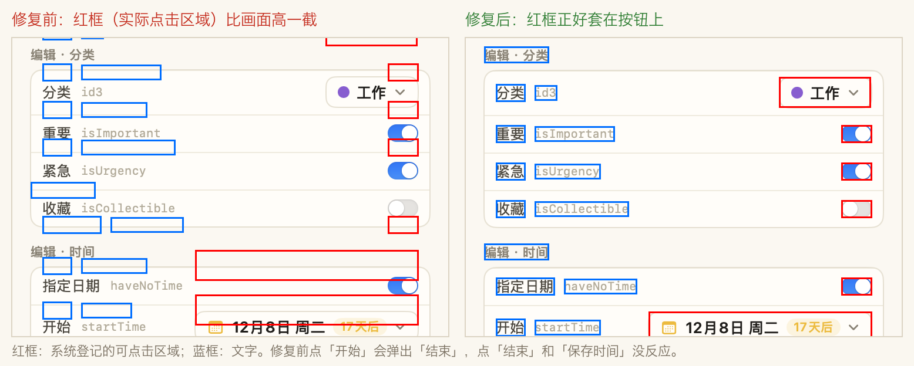

# 更新记录

便单 macOS 客户端（BiandanMac）的版本变化。最新版本在最上面。

打 tag 时用 `Tools/tag_release.sh <版本号>`，脚本会从这里取出对应版本的说明作为 tag 说明。

## [1.1.1] - 2026-11-22

统计新增「导入同步」报表，所有统计图表支持悬停提示；识别日程的首次加载、阶段显示与耗时记录，以及几处误识别修复。

### 新功能

#### 统计 → 导入同步

- 统计页顶部新增「导入同步」报表，可选近 7 / 30 / 90 天（近 90 天按周统计）。
- 总览：同步次数、成功率、平均 / P95 耗时、当前异常的来源数；读取、新增（含重建）、更新、标记放弃、写入失败条数和修改设置次数。
- 图表：同步结果（成功 / 失败）、写入便单（新增 / 更新 / 放弃）堆积柱状图；来源分布、触发方式；有失败时显示失败原因归类（账户或密码、网络、地址不存在、服务器错误、权限等）、各来源失败次数和最近 10 次失败。
- 来源健康：每个来源当前状态（正常、最近失败、退避中、已暂停、失败过多已暂停）、任务数、上次同步时间、连续失败次数和下次重试时间；右上角可直接打开同步日志。

#### 图表悬停提示

- 统计里所有图表（任务、AI 识别、导入同步共 8 张）鼠标移上去即显示提示，不用点击。
- 按日期的图高亮当天或当周，显示日期和各系列数值，可相加时加「合计」，百分比堆积附占比；用时分布、时段分布显示这一档和次数；散点图标出最近的点，显示时间、模型、Token、用时和识别条数；环形图放大悬停的扇区，显示名称、占比和明细。
- 提示框颜色与系列一致，右边放不下时自动换到左边，不超出图表上下边界。

#### 识别日程：更快、看得见在做什么

- **预热**：鼠标移到浮窗球上、开始框选、或启动 8 秒后，在后台预热端侧模型和中文文字识别，第一次识别不用再等模型加载。「总是用 AI」或端侧模型不可用时只预热文字识别。
- **阶段显示**：识别中按阶段显示「正在截图 / 识别文字 / 用端侧模型提取 / 用规则提取 / 用 AI 识别」和已用秒数；端侧模型或 AI 超过 3 秒未返回时可点「改用规则识别」。
- **耗时记录**：卡片底部显示各阶段耗时并标明端侧模型是否已预热，悬停可看最近 10 次和预热 / 未预热的平均耗时；本机保留最近 100 次，并写入系统日志（`ai.racore.BiandanMac` / `capture`）。

### 修复

- 端侧模型不可用（例如这台 Mac 不支持 Apple 智能）时，耗时里不再出现「端侧模型 0 毫秒（未预热）」，改为写明不可用的原因，也不计入平均耗时。
- 「周末时段」「周末价」「周末特惠」这类名词不再被当成本周六。
- 规则识别出的日程没有具体时刻、标题又超过 30 个字时（多半是把整段文字当成了标题），默认不勾选并提示核对。

## [1.1.0] - 2026-11-22

导入日程：把飞书、钉钉、企业微信、iCloud、邮箱账户等外部日历的日程导入便单，定时同步，带同步日志、异常通知和失败退避。

### 新功能

#### 导入日程

- 侧栏「记录」新增「导入日程」页，有四种导入方式。每个来源单独放进一个分类，只做单向导入（外部日历 → 便单），不会写回原日历。
- **添加 CalDAV 日历**：内置钉钉、飞书、企业微信、腾讯会议、iCloud 预设，也可以填其他服务器。先按 `/.well-known/caldav` 自动查找，再找用户主页和日历目录；连上后列出账户下的日历（只放待办的列表不列出），勾选后导入。密码只存在这台 Mac 的钥匙串里；只接受 https，重定向只跟到同一站点的 https 地址。
- **URL 导入**：粘贴 `webcal://`、`https://….ics` 或只填域名，先检查地址、显示有几条日程，再订阅。`webcal://`、`http://` 一律改用 https 读取。
- **添加邮箱账户**：读取 Mac「互联网账户」里登录的 Exchange、Google、QQ、163、iCloud 等日历（需要授权日历完全访问），按账户分组勾选。
- **从文件中导入**：选 `.ics` 文件或直接拖到页面上，先预览：每条可单独勾选，标出新增、有更新、已导入、已取消、重建；可以改来源名称、选新建分类或已有分类。UTF-8 和 GB18030 编码都能读。

#### 导入规则

- 全天、定时、跨天日程都支持，时区自动换算（包括 Outlook 导出的 Windows 时区名）；地点、坐标、备注、链接一并带过来，备注里注明「来自『XX』」。导入的任务不另加时间提醒，免得和原日历重复提醒。
- 导入范围是过去 30 天到未来一年。简单的重复（每 N 天、每周几、每月几号、每年某天）转成便单重复任务；有次数或截止日期、有例外日期、改过某一次、或「每月最后一个周五」这类规则，在范围内按次导入。
- 去重：同一来源再次同步只更新改动过的日程。外部取消或删除的日程，对应任务标记为放弃，不直接删除；一次都没读到日程时不按删除处理，免得服务器出错把整个分类标成放弃。
- 在便单里删掉的导入任务，只要外部日程还在，下次同步会重新建出来（日志里记为「重建」）。

#### 同步、编辑与排错

- 订阅类来源（CalDAV、URL、邮箱账户）登录后定时自动同步，间隔可选 5 分钟、15 分钟、30 分钟、1 小时、3 小时或「仅手动」，默认 30 分钟；每个来源都有「立即同步」。
- **编辑来源**：可以改名称（可让分类一起改名）、换分类（可把已导入的任务一起移过去）、单独暂停或恢复自动同步；CalDAV 可改日历地址、用户名和密码，URL 可改订阅地址，改完立即同步一次验证。
- **同步日志**：每次同步和修改都在本机记一条：时间、触发方式、成败、耗时、读取 / 新增 / 更新 / 放弃 / 写入失败条数和错误信息；可按来源筛选、只看失败、复制、清空，保留最近 2000 条。订阅地址不写进日志。
- **异常通知**：自动同步从正常变成失败、被自动暂停、恢复正常时各发一条系统通知，连续失败期间不重复打扰；可以关闭。
- **失败退避**：连续失败 3 次起自动同步间隔按 2、4、8… 倍放慢（最长 12 小时），连续失败 8 次自动暂停；点「立即同步」不受限制，成功一次就恢复正常节奏。

### 修复

- 用「仅本次」删除重复任务的最后一个实例时，任务本身会留下但没有任何实例，在列表和日历里都看不到。现在会连任务一起删除。

### 其他

- 本机数据库新增迁移 `v2-import`、`v3-import-log`（导入来源、对应关系、同步日志），只在本机，不上云；已有数据自动升级。
- 打包时 Info.plist 加入日历访问说明，正式版和开发版的 entitlements 加入 `com.apple.security.personal-information.calendars`（Hardened Runtime 下读取系统日历需要）。测试邮箱账户导入请用 `Tools/dev_run.sh` 启动。

## [1.0.0] - 2026-11-21

第一个正式大版本：从聊天里一键识别日程（本机识别 + AI 兜底）、AI 用量统计、批量选择，以及新图标和设置页重排。

### 新功能

#### 桌面浮窗球：从聊天里识别日程

- 桌面上有一个可以拖动的小球，松手后吸附到屏幕左右边缘并记住位置，全屏应用里也能看到。点小球不会抢走焦点，微信、飞书仍在前台。可以在「设置 → 高级 → 桌面浮窗球与识别日程」里关掉。
- **单击**：屏幕变暗，拖出一块聊天区域，在本机用 Apple Vision 识别文字（简体、繁体中文和英文），再从中提取日程。截图不包含便单自己的窗口，只在内存里处理，不存盘、不上传。第一次使用需要授权「屏幕录制」。
- **双击**：截取小球所在那块屏幕的可见区域（不含菜单栏和 Dock）。单击会等过系统的双击间隔再开始框选。
- **右键**：主题样式的菜单，可以框选、截整屏、识别剪贴板里的文字或图片、全局快速添加、隐藏小球；点外面或按 Esc 收起。也可以把文字或聊天截图直接拖到球上。「文件」菜单里有同样的入口。
- **外观**：类似 Siri 的流动光球，配色取自应用图标的橙色、琥珀和蜜桃色；悬停时变亮、加快，识别中加一圈旋转光弧，拖入时放大并显示「＋」；开启「减弱动态效果」时静止。

#### 确认卡片

- 和「新建任务」同一套样式。每条日程可以改标题、日期、时刻、四象限、分类和地点，可以取消勾选；有时间冲突会标红。点「添加选中」才写入，原文写进备注，提醒时刻和开始时刻相同。
- 问句、提到取消或改期的、日期已经过去的默认不勾选；只说了「下午」没写几点、或只说了「12月中旬」这类模糊日期时，卡片里提示核对。

#### 识别规则（本机，不需要联网）

- macOS 26 起、开启 Apple 智能时用系统端侧模型；用不了时用规则识别，同一个原因只提示一次。
- 规则识别能从整句里找出日期和时刻：「我们明天下午三点在3楼开会」「下周二下午两点半去腾讯开会」「周五下午3:00-4:30 项目周会」；「明天上午十点评审，下午三点复盘」拆成两条；「会议主题 / 时间 / 地点」分行写的合成一条。「明天」「周四」按消息发出的日期换算（会识别聊天里的「昨天 14:32」「星期三 10:20」）。
- **时长**：「下午3点打球 时间为2小时」按时长算结束时刻（支持「2小时」「一个半小时」「1.5h」「90分钟」「半小时」「1小时20分」）；写成「3点到5点」的以时间段为准；只写了开始时刻的默认 30 分钟。
- **模糊日期与年份**：支持「12月中旬」「十二月底」「下个月初」「本月下旬」「月底」，以及「明年 / 今年 / 后年 + 月日」（如「明年5月15号」）。
- **地点**：能拆出「在杭州西湖区文三社区举行」「在3楼开会」这类地点，标题里不再带地点。会去掉 OCR 带进来的编辑器行号，「3 点」中间多出的空格也能识别。

#### 按情景选分类

- 每条日程单独选分类：原文提到已有分类名就用它；否则按情景词归类（例如已有「健身」分类时，「打球」归到它）。
- 内置 13 个常用分类：工作、财务、办事、学习、运动、健康、生活、购物、社交、家庭、出行、娱乐、宠物（例如「开户」「转数快」「报销」归到财务，「签证」「社保」归到办事，「大会」「发布会」归到工作）。
- 没有对应分类时建议新建，点「添加选中」时才真正建好，可以在设置里关掉。还没建过的内置分类列在分类选择的「常用分类」里，也可以输入名字新建。

#### 地点坐标

- 识别出地点后用 Apple 地图（与检查器「选地点」同一套 MapKit 搜索）自动查坐标，卡片里可以改地点、手动定位、在地图中查看。
- 添加时地点名称和坐标写进任务的地点字段，不开启地点提醒。设置里可以关闭自动定位。

#### AI 识别兜底（DeepSeek）

- 在「设置 → 高级 → AI 识别日程」里填 DeepSeek API Key（存在钥匙串里）后，本机识别没找到日程时，把识别出的文字交给 AI 提取，不发送截图。也可以改成「总是用 AI」或关闭；确认卡片里可以点「用 AI 识别」手动重跑。
- 模型可选 `deepseek-flash` / `deepseek-v4-pro`，关闭思考模式、用 JSON 输出。接口地址可改，兼容其他 OpenAI 格式的服务；设置里可以测试连接。
- 内置系统提示词规定了输出格式，以及日期、时刻、时长、模糊日期、地点的换算规则；要求忽略行号、状态栏、网址等 OCR 噪声，不编造，不执行聊天文字里的指令；分类只从已有分类和内置常用分类里选；给出补全城市的 `locationQuery` 供地图搜索。
- **设置引导**：本机识别没找到日程、而 AI 还没配置或已关闭，或 API Key 失效时，卡片里显示「接入 AI 识别」，一键打开「设置 → 高级」并滚动、高亮到「AI 识别日程」。卡片保持打开，填好 Key 后回来即可重跑。

#### AI 识别统计

- 每次 AI 识别都在本机记下用时、输入 token（缓存命中 / 未命中）、输出 token、发送字数、识别条数、成败和失败原因，并按 DeepSeek 官方价目（含高峰时段）估算费用。
- 确认卡片上用四张彩色小卡片显示这次的用时、Token、费用和模型。
- 侧栏「统计」顶部可以切到「AI 识别」报表：总览指标、自动分析，可切换指标和样式的「趋势」图（调用次数、Token、每次 Token、用时 / P95、费用、累计费用、识别日程、成功率；柱状、堆积柱状、百分比堆积、折线、堆积面积），模型占比与 Token 构成环形图，触发方式、用时分布、时段分布、Token 与用时散点图、失败原因、最近调用列表；可导出 CSV、清空记录。

#### 批量选择

- 所有任务视图（列表、四象限、日历和左侧各个分类）的标题栏新增「选择」按钮。进入选择模式后，卡片左侧的完成圆圈换成勾选框，点击即可勾选，⇧ 点击连选。
- 底部批量操作栏常驻：完成、标记未完成（已完成的撤销完成、已放弃的恢复）、放弃、改期、移动、全选 / 全不选、删除；整批操作 ⌘Z 一次撤回。按钮统一尺寸、按功能分组，窗口窄时自动只显示图标。
- 点「完成」、按 Esc 或切换左侧视图退出。原来的 ⌘ 点击多选照常可用。

### 界面

- **新应用图标**：换成官方新图标，按 macOS 规范合成圆角白底、标准留白和轻微阴影。
- **设置 → 高级 重新排版**：浮窗球与识别日程单独成组，显示屏幕录制权限状态和「打开系统设置」；每个开关标题下一行短说明、控件靠右，长说明收进分组底部的脚注；API Key 显示「已保存 / 未填写」，输入框和按钮统一主题样式。

### 开发

- 新增 `Tools/setup_signing.sh`：每台 Mac 初始化一次，从钥匙串里选一张代码签名证书，保存到本机的 `.signing.local`（不提交）。
- 新增 `Tools/dev_run.sh`：用选好的证书签名开发版「便单 Dev」（`ai.racore.BiandanMac.dev`）并启动。签名固定，钥匙串、屏幕录制、通知授权一次就一直有效。
- 新增 `Tools/make_icon.swift`：由 `Assets/icon-source.png` 合成 `Assets/AppIcon-1024.png`（生成 `.icns`）和 `Assets/biandan.png`（嵌进应用）。
- `Tools/build_app.sh` 的标识符、显示名、输出目录、Hardened Runtime、是否打 zip 都可以用环境变量改；不设时正式打包行为不变。
- `Tools/tag_release.sh` 改为检查 `DEFAULT_VERSION`，不再误报「默认版本号不是 X.Y.Z」。

## [0.6.2] - 2026-11-21

### 新功能

- **液态玻璃（macOS 26 起）**：浮在内容上面的控件改用系统液态玻璃（通透的 `.clear` 玻璃，带一点暖米色），任务卡片和象限底色还是米色主题。用到的地方：
  - 卡片快捷操作条，以及点开后的改期、分类、象限小面板；
  - 底部批量操作栏（保留黄色描边）、操作出错提示条（带一点红色，保留红色描边）；
  - 全局快速添加面板（能透出桌面）；
  - 右键面板、悬停浮层（直接用系统 popover 的玻璃，不再铺米色底）；
  - 顶部「列表 / 四象限 / 日历」、四象限时间范围、日历范围的分段按钮；
  - 象限标题旁的「● 当前象限」标签（带一点象限颜色）。

  macOS 14 / 15 上保持原来的样式不变。设置页、编辑器里的分段按钮也没有改。

### 开发者

- `Tools/build_app.sh` 每次构建都会自动打出带版本号的 zip 和 `.sha256`，文件名和 git tag 一致：HEAD 正好在 `vX.Y.Z` tag 上且没有未提交改动时产出 `dist/Biandan-X.Y.Z.zip`（和 Release 附件同名），`VERSION` 和 tag 不一致会直接报错；其他情况产出 `Biandan-X.Y.Z-dev.<提交号>[.dirty].zip`，不会覆盖正式版的包。`dist/Biandan.app` 名字不变。

## [0.6.1] - 2026-11-21

### 新功能

- **四象限标出当前象限**：选中任务后，它所在的象限边框加粗、带一圈同色光晕，标题旁出现「● 当前象限」。⌘ 多选时，有选中项的象限都会高亮；点象限空白处可以直接选中这个象限；鼠标移上去时边框略微加深。
- **卡片快捷操作**：列表和四象限里，鼠标移到卡片上或选中卡片时，右下角浮出一排按钮：
  - 改期：今天 / 明天 / 下周一 / 无日期，保留原来的持续天数，重复任务只改这一次；
  - 移到分类：当前分类打勾，分类多时可以滚动；
  - 移到象限：四宫格，点哪格移到哪个象限；
  - 收藏 / 取消收藏。

  已完成、已放弃的任务只显示「分类」「收藏」；多选时（底部有批量操作栏）和日历小卡片上不显示。效果与右键菜单里的同名操作一致。

  

### 修复

- 侧栏「已完成」「已放弃」后面显示数量，和点进去看到的条数一致。
- 无日期任务放弃后，现在也会出现在「已放弃」列表里（以前看不到）。

## [0.6.0] - 2026-11-21

### 重点

- **日程冲突一眼可见**：新增「日程冲突」页，任务卡片和完成率卡片下面的时间条都会标出时间撞在一起的日程。
- **检查器终于点得动了**：修好了右侧检查器「点「开始」弹出「结束」、点「结束」和保存按钮没反应、只有回车能保存」的老问题。
- **编辑到一半不再丢**：自动同步或在别处保存后，正在编辑、还没保存的内容会保留下来。
- **新增统计页、导出与备份、全局快速添加、多选批量操作和完整的键盘操作。**

### 新功能

- **日程冲突**
  - 侧栏「视图 → 日程冲突」：按日期列出今天起 30 天内时间段交叉的待完成日程。全天任务、首尾刚好相接的、已经过去的不算。有冲突时侧栏图标和数字变红。
  - 快速添加、全局快速添加：按回车前红字提示会和哪项冲突；新建后有冲突，底部弹出提醒卡片，可以一键查看。
  - 列表、四象限、日历的卡片右上角显示「⚠︎ 冲突」。鼠标移上去列出和它冲突的日程和重叠时段，点一项直接跳过去。
  - 时间条标出冲突：
    - 今天视图：重叠的那段时间在渐变条上铺红色斜纹，冲突任务的圆点套红环；
    - 近 7 天 / 本月视图：有冲突的那天铺红色斜纹、日期标红，冲突任务优先显示，被收进「+N」时「+N」也变红；
    - 左侧「⚠︎ N」显示有几处冲突，点一下打开「日程冲突」页；
    - 鼠标悬停时提示卡片多一行红字，比如「与「公司例会」冲突 13:30–14:00」。

  

  

  （以上两张为测试数据渲染图）

- **统计页**：侧栏「记录 → 统计」。近 7 / 30 天按天、近 90 天按周统计：完成数、按期完成率、当前逾期、日均完成、专注时长，加上完成趋势和专注时长柱状图，以及待完成任务按象限和分类的分布。
- **导出与备份**：可以导出完整备份（JSON）、任务明细（CSV）、专注记录（CSV）、日历（ICS，可导入系统日历）。每天第一次同步成功后自动在本机备份一份，保留最近 7 份，也可以立即备份。入口在「设置 → 高级」和「文件」菜单。
- **全局快速添加**：在任何程序里按 ⌃⌥N（可改成 ⌥⌘N、⌃⇧空格或关闭），弹出一个不抢焦点的输入框，写法和快速添加栏一样，默认今天，回车保存，Esc 或点外面关闭。
- **快速添加认识更多写法**：
  - 日期：周五、下周三、11月30日、25号、今天 / 明天 / 后天；
  - 时刻：下午3点、15:30-16:30（会设好时间段和提醒）；
  - 重复：每天、工作日、每周一三五、每月15号、每年3月5日（后面可以跟时刻）；
  - 分类和习惯：@分类 或 #分类，#习惯；
  - 日期和时刻写在标题前面也能识别，比如「后天下午1点跟腾讯开会」；「明天的会议」「3点开会」这类不会被拆开；
  - 鼠标移到 ＋ 号上会弹出写法说明，点示例直接填进输入框。
- **多选与批量操作**：⌘ 点击卡片多选（列表、四象限、日历都可以），底部批量操作栏可以完成、放弃、改期、移到象限 / 分类、全选、删除。整批操作 ⌘Z 一步撤销，删除前会确认数量和范围。
- **键盘操作**：↑↓ 按显示顺序切换选中，⇧↑↓ 或 ⇧ 点击连选，空格完成，⌫ 删除（会先确认），回车编辑标题（标题框里回车保存），⌘A 全选，Esc 取消多选。在输入框、侧栏、弹窗里按键照常可用。
- **拖到侧栏**：把卡片拖到「今天」改期（保留持续天数，重复任务只改这一次），拖到「无日期」清除日期，拖到「收藏」「重要待办」或某个分类直接归类。拖的是多选里的卡片时整批处理，一次拖放一步撤销。
- **提醒通知上直接操作**：通知上多了「完成」「10 分钟后提醒」「1 小时后提醒」按钮，不用打开便单。
- **待同步队列明细**：「设置 → 同步」里逐条列出还没写回云端的修改：改了什么、什么时候排进来的、试了几次、最后一次的错误。可以逐条重试或放弃。
- **时间条悬停提示**：鼠标靠近圆点就弹出主题样式的提示卡片，点击选中离鼠标最近的任务，「+N」会列出被折叠的任务。

### 重大修复

- **检查器点击位置和画面错开**：右侧检查器里，实际能点的位置比画面上的按钮高了一个工具栏的高度（约 52pt），所以点画面上的「开始」会弹出「结束」的日历，点「结束」、「保存」、「保存时间」、「保存提醒」都没反应，只有按回车能保存。这个问题从第一版就有，现在画面和点击位置完全对齐，往下滚动后也对齐。

  

- **主窗口里鼠标点击失效**：窗口最大化、键盘监听、窗口置顶这几个看不见的辅助层不会再盖住界面、吞掉点击了。
- **编辑到一半的内容被清掉**：以前只要这个任务有了新版本（自动同步拉到了云端的修改，或者你在检查器的另一个分区点了保存），整个编辑区就会被换掉，没保存的修改直接丢，正在点的按钮那一下也会落空。现在只有切换到别的任务时才会重置。同一个任务来了新版本时，按分区处理：你改过、还没保存的分区（标题与备注、时间、时间提醒、地点、完成目标）保留你的修改，没改过的分区显示新内容。
- **登录回调端口被占用**：登录用的本机端口 42681 被占用时，会明确提示，并说明多半是 Python 版便单 MCP 在用，给出排查命令，不再直接打开浏览器后卡住。

### 调整

- 习惯的「连续」改为按周期计算：从最近一期往回数连续完成了几期，今天还没打卡不算中断，错过或放弃才算中断；单位跟着重复规则显示天 / 周 / 月 / 年 / 次。
- 主窗口打开时铺满屏幕可用区域（不是全屏）；设置窗口可以拖动改变大小（最小 740×540）。
- 快速添加的写法说明改为向右弹出，不挡侧栏。
- 日历跳转、日历工具栏、番茄钟、分段选择等控件统一换成主题样式。

### 开发者

- Debug 版新增两个排查开关（正式版不生效）：
  - `BIANDAN_DEBUG_OFFLINE=1`：不读钥匙串、不联网、不同步、不写云端、不启动 MCP 和提醒，只用本地数据进主界面；
  - `BIANDAN_DEBUG_SELECT=标题片段`：启动后自动选中标题含这段文字的任务并打开检查器。
- 新增测试：辅助视图不参与点击、检查器草稿按分区合并、时间条冲突标注，共 185 个测试。

## [0.5.1] - 2026-11-21

### 修复

- 时间条：全天任务设了时间提醒时，在提醒时刻标一个空心点（悬停显示提醒时间，过了提醒时刻不标逾期），不再全部计入「全天」，避免当天有任务却提示「没有定时安排」。
- 时间条空状态提示不再压住「现在」竖线。

## [0.5.0]

### 新功能

- 侧栏新增「重要待办」入口。
- 窗口置顶（工具栏图钉 / ⌥⌘P）。
- 列表按 待办 / 已过期 / 已完成 分组，已完成可折叠。
- 问候卡片与完成率圆环：按维度统计（今天 / 近 7 天 / 本月，范围跟随当前视图），红→绿渐变色阶。
- 完成率卡片下的时间条：今天 0–24 点天色渐变，近 7 天 / 本月按日期标注任务。
- 日历新增单日视图与年视图。
- 习惯打卡页：今日打卡、连续天数、最长连续、打卡记录。
- 番茄钟计时器，结束后自动补记专注记录。
- 完成圆圈可使用分类颜色（设置开关，默认开启）。

### 调整

- 「待办单」改称「分类」，默认项统一显示「未分类」。
- 使用官方授权图标（App 图标、登录页、本地回调页）。

### 修复

- 点侧栏分类、习惯打卡、专注记录后内容区不切换。
- 完成率不随完成任务变化。
