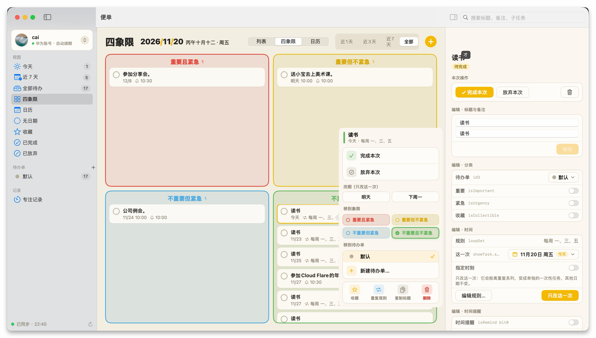
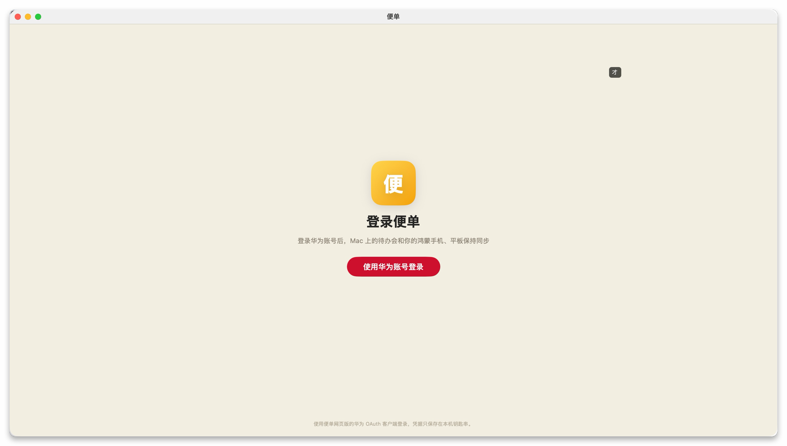
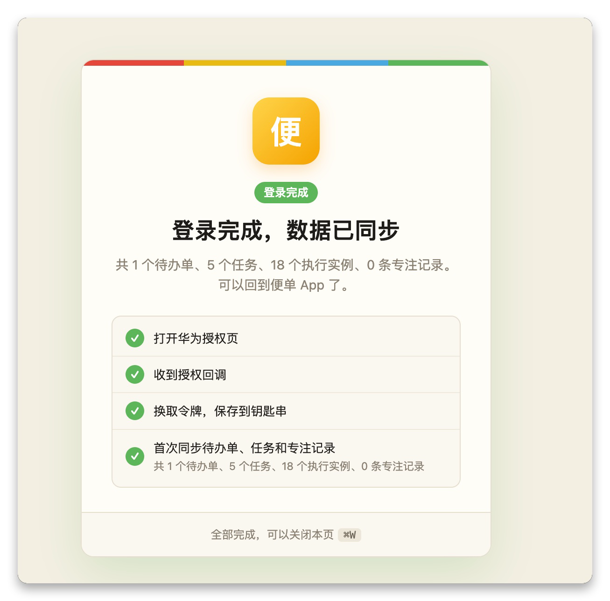

# 便单 for macOS（BiandanMac）

便单的 macOS 原生客户端，用 SwiftUI 开发，支持 macOS 14 及以上版本。用华为账号登录后，Mac 上的待办会和鸿蒙手机、平板上的便单保持同步。凭据只保存在本机钥匙串，到期前自动续期。



<sub>四象限主界面：中间是任务卡片的右键菜单（完成、改期、移到象限 / 待办单、收藏、重复规则、删除），右侧是检查器。</sub>

- 设计与规划：[../docs/macos/plan.md](../docs/macos/plan.md)
- UI 原型：[../docs/macos/ui-prototype.html](../docs/macos/ui-prototype.html)
- 界面规范：[DESIGN.md](DESIGN.md)
- 云端数据模型：[../docs/developers/data-model.md](../docs/developers/data-model.md)
- 授权与续期接口：[../docs/developers/cloud-access.md](../docs/developers/cloud-access.md)

## 功能

| 模块 | 内容 |
|---|---|
| 视图 | 今天、近 7 天、全部待办、四象限、日历、无日期、收藏、已完成、已放弃；四象限可按近 1 天 / 3 天 / 7 天 / 全部筛选 |
| 任务操作 | 完成、撤销、放弃、恢复本次；勾选子任务、记次数；改期（明天、下周一）；在四象限之间拖动；移到其他待办单 |
| 新建与编辑 | 新建一次性或重复任务；在检查器里编辑标题、备注、分类、时间、提醒、地点、完成目标 |
| 重复任务 | 8 种重复方式，支持自定义周 / 月 / 年 / 农历、工作日筛选、持续天数、习惯；改规则前预览新增、改期、移除、保留的实例数；可以只改某一次（脱离系列）；一次性任务可以设为重复 |
| 删除 | 删除前预览影响范围（仅本次 / 本次及之后未完成的 / 整个系列） |
| 日历 | 月视图和周视图（可切换，记住选择）；把任务拖到其他日期即可改期，一次性任务保留持续天数和时刻，重复任务只改这一次 |
| 待办单 | 新建、编辑、删除、排序 |
| 专注记录 | 按本周 / 本月 / 全部浏览；补记、编辑（标题、好坏番茄数）、删除；明细和按日汇总两种视图 |
| 账户 | 华为账号登录；自动续期；显示下次续期时间和还有几天需要重新登录 |
| 同步节流 | 自动同步至少间隔 1 分钟（本地超过 3000 条时 3 分钟），连续失败指数退避（最长 30 分钟），遵守云端 429 的 Retry-After；手动同步不受限 |
| 冲突 | 其他设备同时修改时（409）重新读取并合并：只改了别的字段就自动重试；改了同一个字段则以云端为准，提示「已被其他设备修改」 |
| 离线 | 断网或云端暂时不可用时，后台修改先存进本机待同步队列（outbox），30 秒后和每次同步前按顺序自动重放 |

### 开发进度

- **P0–P3**：工程骨架、编解码、登录续期、只读同步，以及列表、四象限、日历、检查器、专注记录、设置等页面。
- **P4**：写入。完成、撤销、放弃、恢复、勾选子任务、记次数；新建一次性任务；检查器编辑；删除前预览影响范围；四象限拖动；待办单的新建、编辑、删除和排序。
- **P5**：重复任务（见上表）。
- **P6**：专注记录的补记、编辑、删除和按日汇总。

## 登录与续期

<table>
<tr>
<td width="58%"></td>
<td width="42%"></td>
</tr>
<tr>
<td align="center">登录页</td>
<td align="center">浏览器里的登录进度页</td>
</tr>
</table>

1. 点「使用华为账号登录」，App 在 `127.0.0.1:42681` 监听授权回调，并打开浏览器进入华为授权页。
2. 授权后，App 用 PKCE 换取令牌，把 refresh_token 存进钥匙串，随即进行首次全量同步。浏览器页面会实时显示每一步的进度和同步到的数量。
3. 之后访问令牌由 App 自动续期：第一次续期调用便单续期服务的 `/v1/device` 登记设备，之后调用 `/v1/refresh`。华为发了新的 refresh_token 时自动存进钥匙串。


「设置 → 账户」、侧栏账户卡片和账户面板会显示续期状态：

| 项目 | 怎么算 | 准确程度 |
|---|---|---|
| 下次续期 | 续期服务返回的有效期（`expires_in`），减去最多 60 秒的提前量 | 准确 |
| 重新登录 | 拿到当前 refresh_token 的时间 + 180 天；设备凭据若带有更早的到期日，以它为准 | 估算（改密码或撤销授权会提前失效） |

剩余不到 14 天时显示橙色提醒，到期后显示红色「需要重新登录」。

> 端口 42681 和 Python 版便单 MCP 的授权回调端口相同，登录前请先关闭正在等待授权的 MCP。App 和 MCP 不要共用同一份凭据。
>
> 同一台 Mac 上请只运行一个便单：Xcode 调试版和打包版共用同一个本地数据库和钥匙串凭据，同时运行可能互相覆盖修改。

## 快捷键

| 快捷键 | 功能 |
|---|---|
| ⌘N | 新建任务 |
| ⌘R | 立即同步 |
| ⌘1 – ⌘3 | 切换列表 / 四象限 / 日历视图 |
| ⌥⌘I | 显示或隐藏检查器 |
| ⌘T | 回到今天 |
| ⌘Z / ⇧⌘Z | 撤销 / 重做上一步修改（完成、放弃、记次数、勾选子任务、移象限、改字段、收藏、移动待办单、改期、清除日期、专注记录），以反向业务操作写回云端 |
| ⌘, | 打开设置 |
| Esc | 关闭弹窗（新建任务、重复规则、删除确认、待办单编辑、退出登录） |

## 开发

### 用 Xcode 运行

1. 用 Xcode 打开 `BiandanMac/Package.swift`，首次打开会自动拉取 GRDB。
2. 选择 scheme `BiandanMac` 和 `My Mac`，按 ⌘R 运行。

### 打包签名

```bash
# 在 BiandanMac 目录执行，产物在 dist/Biandan.app
Tools/build_app.sh
```

可选环境变量：

| 变量 | 说明 |
|---|---|
| `BIANDAN_SIGN_IDENTITY` | 签名证书的 SHA-1 或名称，默认使用 Developer ID Application 证书 |
| `CONFIG` | `release`（默认）或 `debug` |
| `VERSION` / `BUILD_NUMBER` | 版本号（默认 0.5.0）/ 构建号（默认当前时间 `yyyyMMddHHmm`） |
| `TIMESTAMP=0` | 离线时跳过 Apple 时间戳服务器 |

### 测试

```bash
# 1. 用 Python 参考实现重新生成黄金用例（需要 Python 3.10+；3.9 会自动兼容处理）
python3 Tools/gen_golden.py

# 2. 运行单元测试（也可以在 Xcode 里按 ⌘U）
swift test
```

| 测试文件 | 覆盖内容 |
|---|---|
| `GoldenTests` | 循环实例 ID、taskContent 编解码、重复规则编码、实例窗口展开、进度计算、表单编码、PKCE，逐项和 Python 参考实现对比 |
| `CoreTests` | 日期、农历、颜色、目标、提醒位、专注 log、记录归一化 |
| `StoreTests` | SQLite 差异合并、云端多出的未知字段保留、快照查询、侧栏计数 |
| `RecurrenceDiffTests` / `RuleDraftTests` | 改重复规则前的实例差异预览、规则草稿的编码 |
| `RenewalTests` | 设备凭据到期日解析、旧版凭据兼容、重新登录天数、续期文案 |
| `CallbackPageTests` | 浏览器回调页与登录进度 |
| `ContextMenuRouterTests` / `MenuRenderTests` / `PickerRenderTests` | 主题右键菜单与选择器的路由和渲染 |

### 目录

```
Sources/BiandanMac/
├─ Core/     JSONValue、LocalDate、BusinessID、Codecs、Models、Recurrence、LunarCalendar
├─ Auth/     OAuthFlow（PKCE、回环监听、换码）、AuthCallbackPage、LoginProgress、
│            TokenProvider（钥匙串、续期）、RenewalStatus（续期倒计时）
├─ Cloud/    HTTPTransport、SyncAPIClient、SyncDiagnostics
├─ Store/    LocalStore（GRDB）、DataSnapshot（内存查询、乐观更新）
├─ Sync/     SyncEngine（全量拉取）、BiandanService（写入、重复任务）
├─ App/      BiandanApp、AppModel、Theme、ThemeKit、主题右键菜单与选择器
└─ Views/    登录、侧栏、四象限、列表、日历、检查器、新建任务、重复规则、
             待办单弹窗、账户面板、专注记录、设置
Tests/BiandanMacTests/   单元测试 + Fixtures/golden.json
Tools/
├─ build_app.sh               编译、组装并签名 Biandan.app
├─ BiandanMac.entitlements    签名用的权限声明
└─ gen_golden.py              黄金用例生成脚本
docs/screenshots/             README 截图
```

### 界面主题

所有页面统一沿用四象限主界面的风格，规范见 [DESIGN.md](DESIGN.md)，组件在 `App/ThemeKit.swift`。新增页面必须按这份规范来做。

## 数据位置

| 数据 | 位置 |
|---|---|
| 本地数据库 | `~/Library/Application Support/BiandanMac/biandan.sqlite` |
| 华为凭据 | 钥匙串，服务名 `ai.racore.BiandanMac`，账户名 `huawei-refresh-<续期地址哈希>`；内容为 refresh_token、设备凭据和 refresh_token 的取得时间 |
| 账户昵称与头像 | `UserDefaults`（`biandan.accountProfile`），只用于显示 |

退出登录会删除钥匙串里的凭据，可以选择保留或清除本地缓存。
