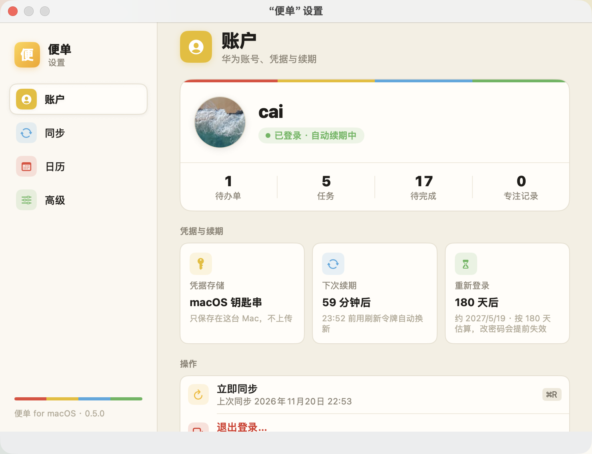

# 便单 for macOS（BiandanMac）

便单的 macOS 原生客户端，用 SwiftUI 开发，支持 macOS 14 及以上版本。用华为账号登录后，Mac 上的待办会和鸿蒙手机、平板上的便单保持同步。凭据只保存在本机钥匙串，到期前自动续期。


每个版本改了什么，见 [更新记录（CHANGELOG）](CHANGELOG.md)。

<sub>四象限主界面：中间是任务卡片的右键菜单（完成、改期、移到象限 / 待办单、收藏、重复规则、删除），右侧是检查器。</sub>

- 设计与规划：[../docs/macos/plan.md](../docs/macos/plan.md)
- UI 原型：[../docs/macos/ui-prototype.html](../docs/macos/ui-prototype.html)
- 界面规范：[DESIGN.md](DESIGN.md)
- 云端数据模型：[../docs/developers/data-model.md](../docs/developers/data-model.md)
- 授权与续期接口：[../docs/developers/cloud-access.md](../docs/developers/cloud-access.md)

## 功能

| 模块 | 内容 |
|---|---|
| 视图 | 今天、近 7 天、全部待办、四象限、日历、无日期、收藏、已完成、已放弃；四象限可按近 1 天 / 3 天 / 7 天 / 全部筛选；记录区有习惯打卡、专注记录、统计 |
| 任务操作 | 完成、撤销、放弃、恢复本次；勾选子任务、记次数；改期（今天、明天、下周一）；在四象限之间拖动；移到其他待办单 |
| 多选与批量 | 按住 ⌘ 点任务卡片多选（列表、四象限、日历通用），底部批量操作栏可以完成、放弃、改期、移到象限 / 待办单、全选、删除；整批合并成一步，⌘Z 一次撤回；删除前确认数量和范围（重复任务只删这一次），删除不能撤销 |
| 拖放 | 卡片拖到侧栏「今天」改到今天（重复任务只改这一次）、「无日期」清除日期（一次性任务）、「收藏」「重要待办」、某个分类；拖到四象限改象限、拖到日历改期；拖的卡片在多选里时整批处理，一次拖放合并成一步撤销 |
| 通知 | 时间提醒通知上可以直接点「完成」（后台执行，不打开主窗口）、「10 分钟后提醒」「1 小时后提醒」 |
| 统计 | 近 7 / 30 天按天、近 90 天按周：完成数、按期完成率、当前逾期、日均完成、专注时长；完成趋势和专注时长柱状图；待完成任务的象限与分类分布（按任务去重） |
| 日程冲突 | 侧栏「视图 → 日程冲突」列出今天起 30 天内时间段有交叉的待完成定时日程（全天任务、首尾相接、今天已过去的时段不算），有冲突时图标和数字变红；快速添加回车前会红字提示「与「X」时间冲突」，新建后有冲突时底部弹出提醒卡片，可一键查看 |
| 冲突角标 | 列表、四象限、日历里和别的日程时间重叠的待办卡片右上角显示红色「⚠︎ 冲突」；鼠标移上去列出冲突的每一项（时间和重叠时段），点一项选中它并滚动过去，不在当前视图时切到「全部待办」再定位 |
| 导出与备份 | 设置 → 高级或「文件」菜单：完整备份 JSON（四张表全部原始字段）、任务明细 CSV、专注记录 CSV（带 BOM，Excel 打开不乱码）、日历 ICS（可导入系统日历）；每天第一次同步成功后在本机自动备份，保留最近 7 份。都是只读，不改云端 |
| 习惯 | 习惯打卡页按周期算连续：每天的习惯按天，每周 / 每月 / 每年的按周 / 月 / 年，工作日、隔天等按次；今天还没打卡不算中断，错过或放弃才算 |
| 新建与编辑 | 内容区顶部的快速添加栏回车即建；新建一次性或重复任务；在检查器里编辑标题、备注、分类、时间、提醒、地点、完成目标 |
| 快速添加写法 | 用空格隔开的词会被识别，其余留在标题里；日期 + 时刻、今天 / 明天 / 后天、带上下午的时刻也可以直接写在标题前面（「后天下午1点跟腾讯开会」「下午3点开会」），「明天的会议」「3点开会」「周一例会」不拆：日期（今天 / 明天 / 后天、周五 / 下周三 / 本周一、11月30日 / 12/1 / 25号）；时刻（下午3点、3点半、15:30-16:30，写了时刻会设时间段并在该时刻提醒，没写上下午的 1–5 点算下午）；重复（每天、工作日、每周一三五、每周末、每两周、每月15号、每月最后一天、每年3月5日，可跟时刻）；`@分类` 或 `#分类`、`#重要`、`#紧急`、`#习惯`；可连写，如「明天下午3点」「每周一8点」 |
| 写法说明 | 鼠标移到快速添加栏的 ＋ 号上，弹出写法说明（日期、时刻、重复、分类与标记、组合示例），点示例填进输入框 |
| 全局快速添加 | 在任何 App 里按 ⌃⌥N（设置里可换 ⌥⌘N / ⌃⇧空格或关闭）弹出浮动输入框，写法同上，没写日期时默认今天；不需要辅助功能权限，快捷键被占用时设置页会提示 |
| 重复任务 | 8 种重复方式，支持自定义周 / 月 / 年 / 农历、工作日筛选、持续天数、习惯；改规则前预览新增、改期、移除、保留的实例数；可以只改某一次（脱离系列）；一次性任务可以设为重复 |
| 地点 | 检查器里可在地图上搜索或点击选点（MapKit），坐标按 GCJ-02 原样保存，也可手动填写经纬度；支持地点提醒开关 |
| 删除 | 删除前预览影响范围（仅本次 / 本次及之后未完成的 / 整个系列） |
| 日历 | 月视图和周视图（可切换，记住选择）；把任务拖到其他日期即可改期，一次性任务保留持续天数和时刻，重复任务只改这一次 |
| 待办单 | 新建、编辑、删除、排序 |
| 专注记录 | 按本周 / 本月 / 全部浏览；补记、编辑（标题、好坏番茄数）、删除；明细和按日汇总两种视图 |
| 账户 | 华为账号登录；自动续期；显示下次续期时间和还有几天需要重新登录 |
| 同步节流 | 自动同步至少间隔 1 分钟（本地超过 3000 条时 3 分钟），连续失败指数退避（最长 30 分钟），遵守云端 429 的 Retry-After；手动同步不受限 |
| 冲突 | 其他设备同时修改时（409）重新读取并合并：只改了别的字段就自动重试；改了同一个字段则以云端为准，提示「已被其他设备修改」 |
| 离线 | 断网或云端暂时不可用时，后台修改先存进本机待同步队列（outbox），30 秒后和每次同步前按顺序自动重放；设置 → 同步里能看到每一条（名称、对象、入队时间、尝试次数、最后一次错误），可逐条重试或放弃 |

### 开发进度

- **P0–P3**：工程骨架、编解码、登录续期、只读同步，以及列表、四象限、日历、检查器、专注记录、设置等页面。
- **P4**：写入。完成、撤销、放弃、恢复、勾选子任务、记次数；新建一次性任务；检查器编辑；删除前预览影响范围；四象限拖动；待办单的新建、编辑、删除和排序。
- **P5**：重复任务（见上表）。
- **P6**：专注记录的补记、编辑、删除和按日汇总。

## 登录与续期

<table>
<tr>
<td width="58%"></td>
<td width="42%"></td>
</tr>
<tr>
<td align="center">登录页</td>
<td align="center">浏览器里的登录进度页</td>
</tr>
</table>

1. 点「使用华为账号登录」，App 在 `127.0.0.1:42681` 监听授权回调，并打开浏览器进入华为授权页。
2. 授权后，App 用 PKCE 换取令牌，把 refresh_token 存进钥匙串，随即进行首次全量同步。浏览器页面会实时显示每一步的进度和同步到的数量。
3. 之后访问令牌由 App 自动续期：第一次续期调用便单续期服务的 `/v1/device` 登记设备，之后调用 `/v1/refresh`。华为发了新的 refresh_token 时自动存进钥匙串。



「设置 → 账户」、侧栏账户卡片和账户面板会显示续期状态：

| 项目 | 怎么算 | 准确程度 |
|---|---|---|
| 下次续期 | 续期服务返回的有效期（`expires_in`），减去最多 60 秒的提前量 | 准确 |
| 重新登录 | 拿到当前 refresh_token 的时间 + 180 天；设备凭据若带有更早的到期日，以它为准 | 估算（改密码或撤销授权会提前失效） |

剩余不到 14 天时显示橙色提醒，到期后显示红色「需要重新登录」。

> 端口 42681 和 Python 版便单 MCP 的授权回调端口相同，登录前请先关闭正在等待授权的 MCP。App 登录前会先检测端口，被占用时不打开浏览器，直接提示占用原因，并给出排查命令 `lsof -nP -iTCP:42681 -sTCP:LISTEN`。App 和 MCP 不要共用同一份凭据。
>
> 同一台 Mac 上请只运行一个便单：Xcode 调试版和打包版共用同一个本地数据库和钥匙串凭据，同时运行可能互相覆盖修改。

## 快捷指令和桌面小组件

- **快捷指令**：打开「快捷指令」App 搜「便单」，有添加日程、今天还有什么、完成日程、识别剪贴板里的日程、在便单里打开日程 5 个指令，也可以直接对 Siri 说「用便单添加日程」。指令在主程序里执行，和界面上的操作走同一套逻辑。
- **桌面小组件**：右键桌面 → 编辑小组件，搜「便单」，添加「便单 · 今天」（小、中、大三种）。点某一条打开便单并定位到它。
- **链接**：`biandan://open`、`biandan://occurrence/<执行实例 ID>`（开发版是 `biandan-dev://`）。
- 小组件在沙盒里，读不到数据库。便单把今天起 3 天的待办写到 `~/Library/Group Containers/G48CJ2J7C8.ai.racore.BiandanMac/widget.json`，小组件只读这一份。便单很久没开时，小组件会提示打开便单更新数据。

## 快捷键

| 快捷键 | 功能 |
|---|---|
| ⌘N | 新建任务 |
| ⌘R | 立即同步 |
| ⌘1 – ⌘3 | 切换列表 / 四象限 / 日历视图 |
| ⌥⌘I | 显示或隐藏检查器 |
| ⌘T | 回到今天 |
| ⌘Z / ⇧⌘Z | 撤销 / 重做上一步修改（完成、放弃、记次数、勾选子任务、移象限、改字段、收藏、移动待办单、改期、清除日期、专注记录、批量操作），以反向业务操作写回云端 |
| ⌘ + 点击 | 把任务卡片加入 / 移出多选，显示批量操作栏 |
| ⇧ + 点击 / ⇧↑↓ | 从上次选中的任务连选到这一项 |
| ↑ / ↓ | 按屏幕顺序移动选中（列表、四象限、日历当前范围） |
| 空格 | 完成 / 撤销完成选中的任务；多选时批量完成 |
| ⌫ | 删除选中的任务（先弹确认）；多选时批量删除 |
| 回车 | 编辑选中任务的标题（标题框里回车保存） |
| ⌘A | 选中当前视图的全部任务 |
| ⌃⌥N | 全局快速添加（在任何 App 里都能用，可在设置里更换） |
| ⌘, | 打开设置 |
| Esc | 关闭弹窗（新建任务、重复规则、删除确认、待办单编辑、退出登录）；没有弹窗且有多选时取消选择 |

方向键、空格、⌫、回车只在焦点不在输入框和侧栏时生效，搜索框、标题框里照常打字。

## 开发

### 开发版签名（每台 Mac 初始化一次）

Xcode ⌘R 和 `swift run` 编出来的是临时签名（adhoc）的裸可执行文件，每次编译签名都会变。系统按签名识别 App，所以钥匙串「始终允许」、屏幕录制、通知这些授权每次都要重新给。改用固定证书签名的开发版，就只用授权一次。

```bash
# 在 BiandanMac 目录执行

# 1. 初始化：从钥匙串里的代码签名证书中选一张，保存到 .signing.local（只在本机，已加入 .gitignore）
Tools/setup_signing.sh            # 列出证书，按序号选择
Tools/setup_signing.sh --list     # 只列出证书
Tools/setup_signing.sh --show     # 查看当前设置
Tools/setup_signing.sh 2          # 直接按序号或 SHA-1 指定

# 2. 以后开发都用这个：编译 debug 版，组装成 .build/dev/BiandanDev.app，用选好的证书签名后启动
Tools/dev_run.sh
Tools/dev_run.sh --no-open        # 只编译签名，不启动
Tools/dev_run.sh --offline        # 以 BIANDAN_DEBUG_OFFLINE=1 启动
Tools/dev_run.sh BIANDAN_DEBUG_SELECT=腾讯分享会   # 传环境变量给 App
```

说明：

- 开发版叫「便单 Dev」，标识符是 `ai.racore.BiandanMac.dev`，和正式版分开授权，互不影响。
- 建议选「Apple Development」证书；「Developer ID Application」也可以用。
- 开发版和正式版共用钥匙串里的登录凭据和 `~/Library/Application Support/BiandanMac` 下的本地数据。第一次读钥匙串时会问一次，点「始终允许」即可。
- 两个版本不要同时开着，否则 MCP 端口和全局快捷键会冲突。`dev_run.sh` 检测到正式版在运行时会提醒。
- 第一次初始化时如果提示 codesign 用不了私钥，请在系统自带的「终端.app」里重新运行，弹窗里输入登录密码，然后点「始终允许」。
- 要断点调试：先用 `Tools/dev_run.sh` 启动，再在 Xcode 里选 Debug → Attach to Process →「便单 Dev」。开发版没有开 Hardened Runtime，并且带有 `get-task-allow`，调试器可以附加。

### 快捷指令和小组件的打包

- 快捷指令的元数据（`Metadata.appintents`）Xcode 会自动生成，`swift build` 不会。`Tools/build_app.sh` 编译时加上常量元数据参数（协议列表在 `Tools/appintents-protocols.json`），编完调用 `appintentsmetadataprocessor` 生成。
- 小组件是单独的扩展（`Widget/`，源码在 `Widget/Sources`，和主程序共用 `Sources/BiandanMac/Widget/WidgetShared.swift`）。打包时用 xcodegen 按 `Widget/project.yml` 生成工程（不提交），xcodebuild 编译后放进 `Contents/PlugIns`。需要先 `brew install xcodegen`；不想编小组件时用 `WIDGET=0`。
- 扩展的权限（沙盒 + App Group）在签名时写入，不放在 xcodegen 里（xcodegen 会把权限文件覆盖成空的）。
- 小组件库里看不到「便单」时，先看是不是同一个标识符登记了好几份：`lsregister -dump | grep BiandanDev.app`。`dev_run.sh` 启动前会自动注销其他位置的登记；还不行就 `killall chronod` 重启小组件服务。

### 用 Xcode 运行

1. 用 Xcode 打开 `BiandanMac/Package.swift`，首次打开会自动拉取 GRDB。
2. 选择 scheme `BiandanMac` 和 `My Mac`，按 ⌘R 运行。

这样跑出来的是临时签名，涉及钥匙串、屏幕录制、通知的功能每次编译后都会重新弹授权。只看界面时可以在 scheme 的环境变量里加 `BIANDAN_DEBUG_OFFLINE=1`；要用完整功能请用上面的 `Tools/dev_run.sh`。

### 打包签名

```bash
# 在 BiandanMac 目录执行
Tools/build_app.sh
```

产物：

- `dist/Biandan.app`：签好名的 App（名字固定，拖进「应用程序」后升级会直接覆盖旧版）；
- `dist/Biandan-<版本>.zip` 和 `.zip.sha256`：带版本号的压缩包，文件名与 git tag 一致：
  - HEAD 正好在 `vX.Y.Z` tag 上且没有未提交改动：`Biandan-X.Y.Z.zip`，和 GitHub Release 的附件同名，可以直接上传；这时用 `VERSION` 指定别的版本号会报错；
  - 其他情况（tag 之后又有提交，或有未提交改动）：`Biandan-X.Y.Z-dev.<提交号>.zip`，有未提交改动时再加 `.dirty`，不会覆盖正式版的包。

可选环境变量：

| 变量 | 说明 |
|---|---|
| `BIANDAN_SIGN_IDENTITY` | 签名证书的 SHA-1 或名称，默认使用 Developer ID Application 证书 |
| `CONFIG` | `release`（默认）或 `debug` |
| `VERSION` / `BUILD_NUMBER` | 版本号（在 tag 上时取 tag，否则默认 1.2.0）/ 构建号（默认当前时间 `yyyyMMddHHmm`） |
| `TIMESTAMP=0` | 离线时跳过 Apple 时间戳服务器 |
| `NOTARIZE=1` | 签名后提交 Apple 公证并钉入票据（需先保存 notarytool 凭据，见「自动更新」） |
| `FEED_URL` / `SPARKLE_PUBLIC_KEY` | 自动更新的 appcast 地址和 EdDSA 公钥，默认写好；开发版不写入 |
| `WIDGET=0` | 不编译桌面小组件扩展（编译需要 xcodegen） |
| `APP_GROUP` / `URL_SCHEME` | 小组件共享数据的 App Group 和链接 scheme，默认按标识符：正式版 `biandan`，开发版 `biandan-dev` |
| `BUNDLE_ID` / `DISPLAY_NAME` / `DIST` / `APP_FILE` / `ENTITLEMENTS` | 标识符、显示名、输出目录、`.app` 文件名、权限文件。供 `Tools/dev_run.sh` 组装开发版用，正式打包不用设 |
| `HARDENED=0` | 不启用 Hardened Runtime（开发版用，方便调试器附加） |
| `PACKAGE=0` | 只生成 `.app`，不打 zip |

### 自动更新（Sparkle）

正式版用 [Sparkle 2](https://sparkle-project.org) 自动更新：每天检查一次 `https://www.aigslb.link/biandan/mac/update/appcast.xml`，发现新版本弹窗显示更新说明，用户确认后下载、校验、替换并重启。设置 → 关于里可以手动「检查更新」、关掉自动检查、打开「自动下载并安装」或「接收测试版」；菜单「便单 → 检查更新…」也可以。开发版（`ai.racore.BiandanMac.dev`）不检查更新。

- **签名**：每个更新包都用 EdDSA 私钥签名，公钥写在 Info.plist（`SUPublicEDKey`）。私钥只在登录钥匙串里（账户 `ai.racore.BiandanMac`），不进仓库。**私钥丢了，已安装的便单就不认新的更新包**，务必备份：
  `.build/artifacts/sparkle/Sparkle/bin/generate_keys --account ai.racore.BiandanMac -x ~/biandan-sparkle-private.key`（导出后放进密码管理器，删掉文件）；换机器导入用 `-f <文件>`。
- **公证**：第一次先保存凭据 `xcrun notarytool store-credentials biandan-notary --apple-id <Apple ID> --team-id G48CJ2J7C8`（粘贴 App 专用密码）。之后 `NOTARIZE=1 Tools/build_app.sh` 签名后自动公证并钉入票据（`Tools/notarize.sh`）。
- **发布一个新版本**：
  1. 更新 CHANGELOG，提交，`Tools/tag_release.sh X.Y.Z --push`；
  2. `Tools/make_update.sh`：打包、公证，在 `dist/update/` 生成 `Biandan-X.Y.Z.zip`、`Biandan-X.Y.Z.html`（更新说明，取自 CHANGELOG）、增量包和签过名的 `appcast.xml`。`--channel beta` 只推给打开了测试版的人，`--skip-build` 用 dist/ 里已有的包；
  3. 把 `dist/update/` 同步到服务器，`appcast.xml` 最后传。`dist/update/` 本机要留着，下一版靠它保留旧条目、生成增量包。
- **服务器**：只需静态文件 + HTTPS。`appcast.xml` 建议 `Cache-Control: max-age=300`；目录里不存在的文件要返回 404，不要兜底到网页首页，否则 App 会把首页当 appcast 解析报错。撤回某个版本：从 appcast.xml 删掉那一条。

### 测试

```bash
# 1. 用 Python 参考实现重新生成黄金用例（需要 Python 3.10+；3.9 会自动兼容处理）
python3 Tools/gen_golden.py

# 2. 运行单元测试（也可以在 Xcode 里按 ⌘U）
swift test
```

| 测试文件 | 覆盖内容 |
|---|---|
| `GoldenTests` | 循环实例 ID、taskContent 编解码、重复规则编码、实例窗口展开、进度计算、表单编码、PKCE，逐项和 Python 参考实现对比 |
| `CoreTests` | 日期、农历、颜色、目标、提醒位、专注 log、记录归一化 |
| `StoreTests` | SQLite 差异合并、云端多出的未知字段保留、快照查询、侧栏计数 |
| `RecurrenceDiffTests` / `RuleDraftTests` | 改重复规则前的实例差异预览、规则草稿的编码 |
| `RenewalTests` | 设备凭据到期日解析、旧版凭据兼容、重新登录天数、续期文案 |
| `CallbackPageTests` | 浏览器回调页与登录进度 |
| `LoopbackPortTests` | 登录回调端口占用探测（真实占用一个端口验证）与监听错误分类 |
| `HabitTests` | 习惯打卡汇总、按周期计算连续、连续的单位 |
| `BatchUndoTests` | 批量操作合并撤销的执行顺序、批量删除确认文案 |
| `KeyboardNavTests` | 方向键移动、连选范围 |
| `QuickAddTests` / `QuickAddParsingTests` | 快速添加的日期、时刻、重复、@分类、中文数字解析 |
| `GlobalHotKeyTests` | 全局快捷键组合与注册失败提示 |
| `ReminderActionTests` | 通知操作按钮、稍后提醒标识与清理 |
| `SidebarDropTests` | 拖到侧栏各项时实际要改的任务、多选整批展开 |
| `OutboxDisplayTests` | 待同步队列明细的对象和时间文案 |
| `DataExportTests` | CSV 转义与 BOM、ICS 全天 / 定时事件、转义与折行、JSON 备份保留原始字段、备份保留份数 |
| `StatsTests` | 统计的完成数、按期完成率、逾期、按周汇总、按任务去重的分布 |
| `ScheduleConflictTests` | 日程冲突：交叉与首尾相接、连锁分组、跨天、全天 / 已完成 / 已过去不算、新建时间段的冲突与提示文案 |
| `ContextMenuRouterTests` / `MenuRenderTests` / `PickerRenderTests` | 主题右键菜单与选择器的路由和渲染 |

### 目录

```
Sources/BiandanMac/
├─ Core/     JSONValue、LocalDate、BusinessID、Codecs、Models、Recurrence、LunarCalendar
├─ Auth/     OAuthFlow（PKCE、回环监听、换码）、AuthCallbackPage、LoginProgress、
│            TokenProvider（钥匙串、续期）、RenewalStatus（续期倒计时）
├─ Cloud/    HTTPTransport、SyncAPIClient、SyncDiagnostics
├─ Store/    LocalStore（GRDB）、DataSnapshot（内存查询、乐观更新）
├─ Sync/     SyncEngine（全量拉取）、BiandanService（写入、重复任务）
├─ App/      BiandanApp、AppModel、Theme、ThemeKit、主题右键菜单与选择器
└─ Views/    登录、侧栏、四象限、列表、日历、检查器、新建任务、重复规则、
             待办单弹窗、账户面板、专注记录、设置
Tests/BiandanMacTests/   单元测试 + Fixtures/golden.json
Tools/
├─ build_app.sh               编译、组装并签名 Biandan.app
├─ BiandanMac.entitlements    签名用的权限声明
└─ gen_golden.py              黄金用例生成脚本
docs/screenshots/             README 截图
```

### 界面主题

所有页面统一沿用四象限主界面的风格，规范见 [DESIGN.md](DESIGN.md)，组件在 `App/ThemeKit.swift`。新增页面必须按这份规范来做。

## 数据位置

| 数据 | 位置 |
|---|---|
| 本地数据库 | `~/Library/Application Support/BiandanMac/biandan.sqlite` |
| 华为凭据 | 钥匙串，服务名 `ai.racore.BiandanMac`，账户名 `huawei-refresh-<续期地址哈希>`；内容为 refresh_token、设备凭据和 refresh_token 的取得时间 |
| 账户昵称与头像 | `UserDefaults`（`biandan.accountProfile`），只用于显示 |
| 本地自动备份 | `~/Library/Application Support/BiandanMac/Backups/biandan-backup-<日期>.json`，保留最近 7 份 |

退出登录会删除钥匙串里的凭据，可以选择保留或清除本地缓存。
